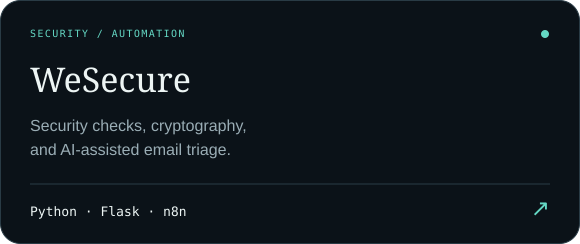
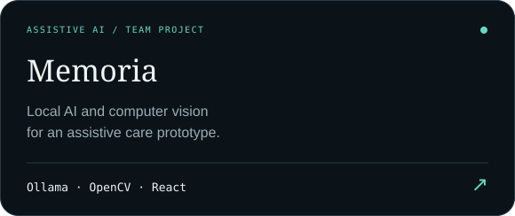
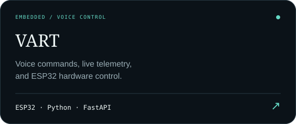
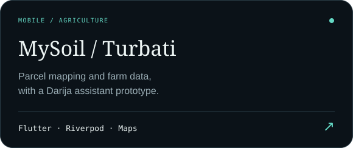
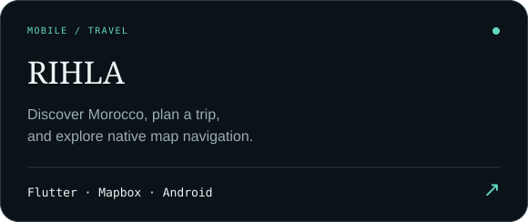
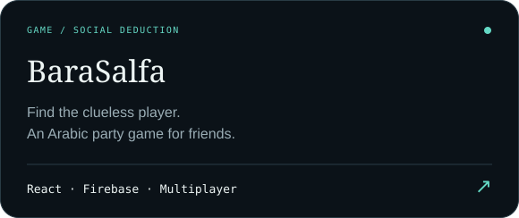
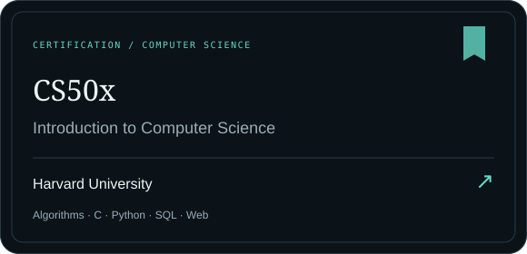
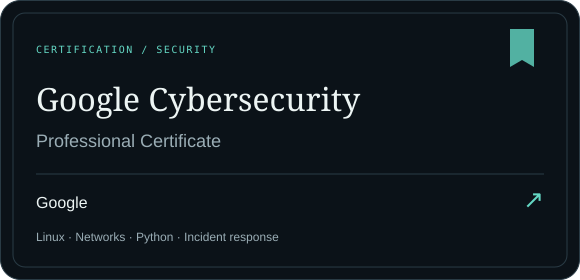

<picture><source media="(prefers-color-scheme: dark)" srcset="assets/header-dark.svg"><source media="(prefers-color-scheme: light)" srcset="assets/header-light.svg"></picture>

<a href="https://marwane-haddane.web.app/">Portfolio</a> · <a href="https://www.linkedin.com/in/marwane-haddane/">LinkedIn</a> · <a href="mailto:marwanehaddane5@gmail.com">Email</a>

### About

I’m **Marwane Haddane**, a fourth-year **Cybersecurity and Digital Development** student at **ENSA Fès** (Class of 2028). I build security tools, AI prototypes, web and mobile applications, and connected systems.

My interests span ethical hacking, workflow automation, computer vision, and robotics. I’m **President of RoboGenius**, **Founder & Lead Organizer of GDGoC ENSAF**, and involved in **External Affairs at SECOPS**.

**Seeking an international research internship in cybersecurity or AI for Summer 2027.**

### Education & community

<picture><source media="(prefers-color-scheme: dark)" srcset="assets/community-dark.svg"><source media="(prefers-color-scheme: light)" srcset="assets/community-light.svg"></picture>

**Recognition:** 1st Prize · GDG OpportunAI · Casablanca, 2025.

### Selected projects

<a href="https://github.com/Marwane-Haddane/WeSecure"><picture><source media="(prefers-color-scheme: dark)" srcset="assets/card-wesecure-dark.svg"><source media="(prefers-color-scheme: light)" srcset="assets/card-wesecure-light.svg"></picture></a>
<a href="https://github.com/Marwane-Haddane/memoria"><picture><source media="(prefers-color-scheme: dark)" srcset="assets/card-memoria-dark.svg"><source media="(prefers-color-scheme: light)" srcset="assets/card-memoria-light.svg"></picture></a>
<a href="https://github.com/Marwane-Haddane/VART"><picture><source media="(prefers-color-scheme: dark)" srcset="assets/card-vart-dark.svg"><source media="(prefers-color-scheme: light)" srcset="assets/card-vart-light.svg"></picture></a>
<a href="https://marwane-haddane.web.app/project/10/"><picture><source media="(prefers-color-scheme: dark)" srcset="assets/card-mysoil-dark.svg"><source media="(prefers-color-scheme: light)" srcset="assets/card-mysoil-light.svg"></picture></a>
<a href="https://marwane-haddane.web.app/project/11/"><picture><source media="(prefers-color-scheme: dark)" srcset="assets/card-rihla-dark.svg"><source media="(prefers-color-scheme: light)" srcset="assets/card-rihla-light.svg"></picture></a>
<a href="https://bara-salfa-by-marwane.web.app/"><picture><source media="(prefers-color-scheme: dark)" srcset="assets/card-barasalfa-dark.svg"><source media="(prefers-color-scheme: light)" srcset="assets/card-barasalfa-light.svg"></picture></a>

### Apps & live websites

| Project | Access |
|---|---|
| BaraSalfa | [Play in your browser](https://bara-salfa-by-marwane.web.app/) |
| Memoria | [Explore the assistive AI prototype](https://memoria-9eac1.web.app/) |
| La Belle Maison | [Visit the furniture storefront](https://labelle-maison.web.app/) |
| RoboGenius | [Explore the engineering club](https://robogenius.vercel.app/) |
| MySoil / Turbati | [Mobile prototype details](https://marwane-haddane.web.app/project/10/) · No public APK listed |
| RIHLA | [Android prototype details](https://marwane-haddane.web.app/project/11/) · No public APK listed |

### Stack

<picture><source media="(prefers-color-scheme: dark)" srcset="assets/stack-dark.svg"><source media="(prefers-color-scheme: light)" srcset="assets/stack-light.svg"></picture>

### Certifications

<picture><source media="(prefers-color-scheme: dark)" srcset="assets/certifications-dark.svg"><source media="(prefers-color-scheme: light)" srcset="assets/certifications-light.svg"></picture>

<a href="https://certificates.cs50.io/9b8fa55f-f037-4ffe-95af-85d90b1bb996.pdf"><picture><source media="(prefers-color-scheme: dark)" srcset="assets/cert-cs50-dark.svg"><source media="(prefers-color-scheme: light)" srcset="assets/cert-cs50-light.svg"></picture></a>
<a href="https://www.credly.com/badges/0a29ef8f-3456-49f6-9efd-95d20de84e39/public_url"><picture><source media="(prefers-color-scheme: dark)" srcset="assets/cert-google-dark.svg"><source media="(prefers-color-scheme: light)" srcset="assets/cert-google-light.svg"></picture></a>

Official certificates and verification links

| Credential | Issuer | Verification |
|---|---|---|
| CS50x: Introduction to Computer Science | Harvard University | [View credential](https://certificates.cs50.io/9b8fa55f-f037-4ffe-95af-85d90b1bb996.pdf) |
| Google Cybersecurity: Professional Certificate | Google | [View credential](https://www.credly.com/badges/0a29ef8f-3456-49f6-9efd-95d20de84e39/public_url) |

[Browse certificate gallery](certificates/README.md)

### Activity

Coding practice · LeetCode

---

Fès, Morocco · <a href="mailto:marwanehaddane5@gmail.com">marwanehaddane5@gmail.com</a>

