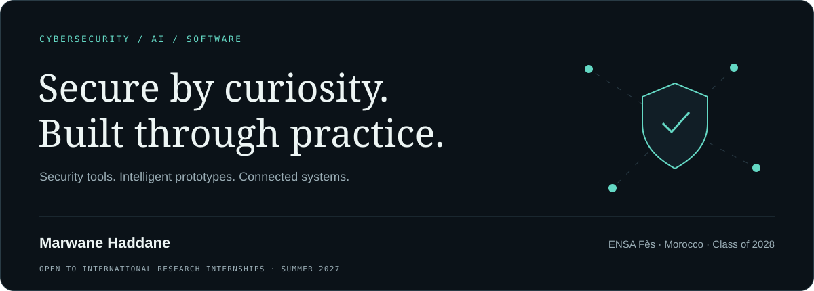
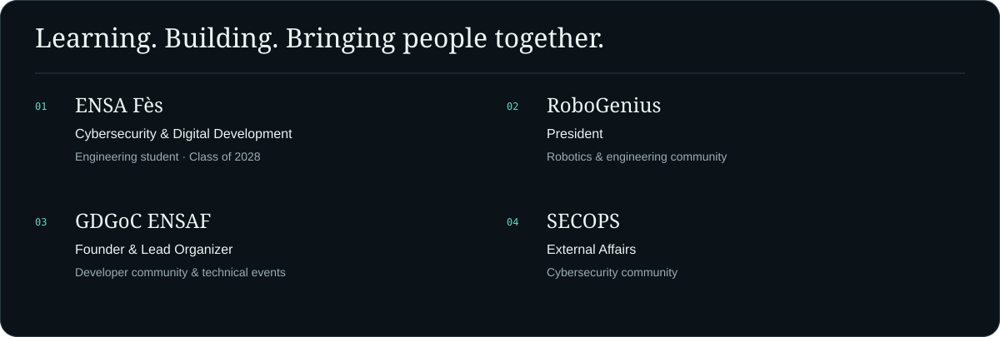
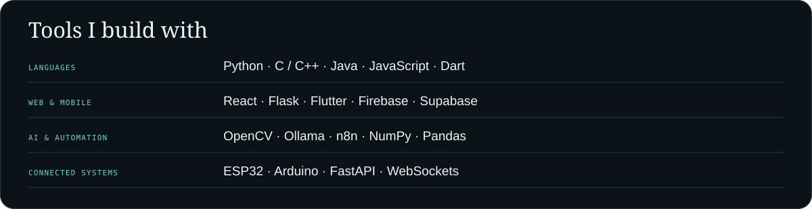

<picture><source media="(prefers-color-scheme: dark)" srcset="assets/header-dark.svg"><source media="(prefers-color-scheme: light)" srcset="assets/header-light.svg"></picture>

<a href="https://marwane-haddane.web.app/">Portfolio</a> · <a href="https://www.linkedin.com/in/marwane-haddane/">LinkedIn</a> · <a href="mailto:marwanehaddane5@gmail.com">Email</a>

### About

I’m **Marwane Haddane**, a fourth-year **Cybersecurity and Digital Development** student at **ENSA Fès** (Class of 2028). I build security tools, AI prototypes, web and mobile applications, and connected systems.

My interests span ethical hacking, workflow automation, computer vision, and robotics. I’m **President of RoboGenius**, **Founder & Lead Organizer of GDGoC ENSAF**, and involved in **External Affairs at SECOPS**.

**Seeking an international research internship in cybersecurity or AI for Summer 2027.**

### Education & community

<picture><source media="(prefers-color-scheme: dark)" srcset="assets/community-dark.svg"><source media="(prefers-color-scheme: light)" srcset="assets/community-light.svg"></picture>

**Recognition:** 1st Prize · GDG OpportunAI · Casablanca, 2025.

### Download my apps

| App | What it does | Android | Windows |
|---|---|---|---|
| **SlideLink** | Phone trackpad, presentation remote, and screen preview | [Download APK](https://github.com/Marwane-Haddane/Marwane-Haddane/raw/refs/heads/main/downloads/SlideLink-Android-0.3.0.apk) | Public installer upload pending |
| **Orbit** | Phone companion for a Windows PC | [Download APK](https://github.com/Marwane-Haddane/Marwane-Haddane/raw/refs/heads/main/downloads/Orbit-Android.apk) | Public portable build upload pending |
| **Rihlaty / RIHLA** | Morocco travel, trip planning, and native maps | Public APK upload pending | — |
| **BaraSalfa** | Arabic social-deduction party game | APK build not found yet | — |
| **La Belle Maison / Furniture** | Furniture browsing and ordering prototype | Public APK upload pending | — |
| **MySoil / Turbati** | Parcel mapping and agricultural information | Public APK upload pending | — |

[Download checksums](downloads/SHA256SUMS.txt). These are development builds; SlideLink and Orbit use a companion desktop app for their PC features.

### Stack

<picture><source media="(prefers-color-scheme: dark)" srcset="assets/stack-dark.svg"><source media="(prefers-color-scheme: light)" srcset="assets/stack-light.svg"></picture>

### Certifications

<a href="certificates/README.md"><picture><source media="(prefers-color-scheme: dark)" srcset="assets/certifications-dark.svg"><source media="(prefers-color-scheme: light)" srcset="assets/certifications-light.svg"></picture></a>

<a href="certificates/README.md"><b>Browse my certificate wall ↗</b></a>

Details and verification links

| Certificate | Issuer | Date | Credential |
|---|---|---|---|
| CS50x: Introduction to Computer Science | Harvard University | 2026 | [View](https://cs50.harvard.edu/certificates/9b8fa55f-f037-4ffe-95af-85d90b1bb996) |
| Accelerate Your Job Search with AI | Google | Jun 2026 | [View](https://coursera.org/verify/GGCU2TIPXQVL) |
| Assets, Threats, and Vulnerabilities | Google | Jun 2026 | [View](https://coursera.org/verify/SEBED6F4BU1Z) |
| Automate Cybersecurity Tasks with Python | Google | Jun 2026 | [View](https://coursera.org/verify/5SF0V47SO2OB) |
| Connect and Protect: Networks and Network Security | Google | Apr 2026 | [View](https://coursera.org/verify/5P15IVIYLN9M) |
| Foundations of Cybersecurity | Google | Feb 2026 | [View](https://coursera.org/verify/R4HUDRWYTM16) |
| Google Cybersecurity Professional Certificate | Google | 2026 | [View](https://www.credly.com/badges/0a29ef8f-3456-49f6-9efd-95d20de84e39/public_url) |
| Play It Safe: Manage Security Risks | Google | Mar 2026 | [View](https://coursera.org/verify/6B5SAX66B155) |
| Put It to Work: Prepare for Cybersecurity Jobs | Google | Jun 2026 | [View](https://coursera.org/verify/R54TA5D29UFL) |
| Sound the Alarm: Detection and Response | Google | Jun 2026 | [View](https://coursera.org/verify/NFCZ6A330Y4P) |
| Tools of the Trade: Linux and SQL | Google | Apr 2026 | [View](https://coursera.org/verify/ULJAELPPYCFC) |
| Delivering Quality Work with Agility | IBM | Jan 2026 | [View](https://coursera.org/verify/KAJVII0EZU8J) |
| Introduction to Front-End Development | Meta | Jul 2025 | [View](https://coursera.org/verify/BSCP1B2EP78I) |
| Programming with JavaScript | Meta | Dec 2025 | [View](https://coursera.org/verify/X2FAPH0GMCYB) |
| AWS Security and Cost Management Concepts | DataCamp | Nov 2025 | [View](certificates/images/aws-security-and-cost-management-concepts.svg) |
| Introduction to Git | DataCamp | Mar 2026 | [View](https://www.datacamp.com/completed/statement-of-accomplishment/course/74c598de78a0536dc4fc35ddeb2d512203f3c2a6) |
| Working with Hugging Face | DataCamp | Feb 2026 | [View](https://www.datacamp.com/completed/statement-of-accomplishment/course/a1acbfd19378c99e98be66ba1179665a8f962956) |
| Working with Llama 3 | DataCamp | Feb 2026 | [View](https://www.datacamp.com/completed/statement-of-accomplishment/course/815f10e4d5f6a9b1ce0e77f6a3907bfcbba44092) |
| Introduction to Jupyter | 365 Data Science | 2024 | [View](https://learn.365datascience.com/c/a4d6354547/) |
| Introduction to Python | 365 Data Science | Nov 2025 | [View](https://learn.365datascience.com/c/b0e4a331c4/) |

## 🌐 Let's Connect:

  
  

## 📈 GitHub Stats

  
  

 

  
  

[View contributions on GitHub](https://github.com/Marwane-Haddane?tab=overview)

Coding practice · LeetCode

---

Fès, Morocco · <a href="mailto:marwanehaddane5@gmail.com">marwanehaddane5@gmail.com</a>

