<picture><source media="(prefers-color-scheme: dark)" srcset="assets/header-dark.svg"><source media="(prefers-color-scheme: light)" srcset="assets/header-light.svg"></picture>

<a href="https://marwane-haddane.web.app/">Portfolio</a> · <a href="https://www.linkedin.com/in/marwane-haddane/">LinkedIn</a> · <a href="mailto:marwanehaddane5@gmail.com">Email</a>

### About

I’m **Marwane Haddane**, a fourth-year **Cybersecurity and Digital Development** student at **ENSA Fès** (Class of 2028). I build security tools, AI prototypes, web and mobile applications, and connected systems.

My interests span ethical hacking, workflow automation, computer vision, and robotics. I’m **President of RoboGenius**, **Founder & Lead Organizer of GDGoC ENSAF**, and involved in **External Affairs at SECOPS**.

**Seeking an international research internship in cybersecurity or AI for Summer 2027.**

### Education & community

<picture><source media="(prefers-color-scheme: dark)" srcset="assets/community-dark.svg"><source media="(prefers-color-scheme: light)" srcset="assets/community-light.svg"></picture>

**Recognition:** 1st Prize · GDG OpportunAI · Casablanca, 2025.

### Download my apps

| App | What it does | Android | Windows |
|---|---|---|---|
| **[SlideLink](https://github.com/Marwane-Haddane/slidelink)** | Phone trackpad, presentation remote, and screen preview | [Download APK](https://github.com/Marwane-Haddane/slidelink/releases/download/v0.3.0/SlideLink-Android-0.3.0.apk) | [Download installer](https://github.com/Marwane-Haddane/slidelink/releases/download/v0.3.0/SlideLink-Windows-Setup-0.3.0.exe) |
| **[Orbit](https://github.com/Marwane-Haddane/orbit)** | Phone companion for a Windows PC | [Download APK](https://github.com/Marwane-Haddane/orbit/releases/download/v0.1.2/Orbit-Android.apk) | [Download Windows ZIP](https://github.com/Marwane-Haddane/orbit/releases/download/v0.1.2/Orbit-Windows-x64.zip) |
| **[Moru](https://github.com/Marwane-Haddane/moru-desktop)** | AI desktop companion for Windows | — | [Download Windows ZIP](https://github.com/Marwane-Haddane/moru-desktop/releases/download/v0.2.0-preview.1/Moru-0.2.0-win-x64.zip) |
| **[Rihlaty / RIHLA](https://github.com/Marwane-Haddane/rihla-app)** | Morocco travel, trip planning, and native maps | [Download APK](https://github.com/Marwane-Haddane/rihla-app/releases/latest/download/RIHLA-Android.apk) | — |
| **[BaraSalfa](https://github.com/Marwane-Haddane/barasalfa-app)** | Arabic social-deduction party game | [Android source](https://github.com/Marwane-Haddane/barasalfa-app) · APK not released | [Play web](https://bara-salfa-by-marwane.web.app/) |
| **[La Belle Maison / Furniture](https://github.com/Marwane-Haddane/furniture-mobile-app)** | Furniture browsing and ordering prototype | [Download APK](https://github.com/Marwane-Haddane/furniture-mobile-app/releases/latest/download/Furniture-Android.apk) | — |
| **[MySoil / Turbati](https://github.com/Marwane-Haddane/mysoil-app)** | Parcel mapping and agricultural information | [Download APK (arm64)](https://github.com/Marwane-Haddane/mysoil-app/releases/latest/download/MySoil-Android-arm64.apk) | — |

**Latest updates:** [SlideLink](https://github.com/Marwane-Haddane/slidelink/releases) · [Orbit](https://github.com/Marwane-Haddane/orbit/releases) · [Moru](https://github.com/Marwane-Haddane/moru-desktop/releases) · [RIHLA](https://github.com/Marwane-Haddane/rihla-app/releases) · [Furniture](https://github.com/Marwane-Haddane/furniture-mobile-app/releases) · [MySoil](https://github.com/Marwane-Haddane/mysoil-app/releases).

Downloads are hosted in each app's own repository. Private repository downloads require GitHub access. These are development builds; SlideLink and Orbit use a companion desktop app for their PC features.

### Stack

<picture><source media="(prefers-color-scheme: dark)" srcset="assets/stack-dark.svg"><source media="(prefers-color-scheme: light)" srcset="assets/stack-light.svg"></picture>

### Certifications

<a href="https://marwane-haddane.github.io/Marwane-Haddane/certificates/"><picture><source media="(prefers-color-scheme: dark)" srcset="assets/cert-wall-v2-dark.svg"><source media="(prefers-color-scheme: light)" srcset="assets/cert-wall-v2-light.svg">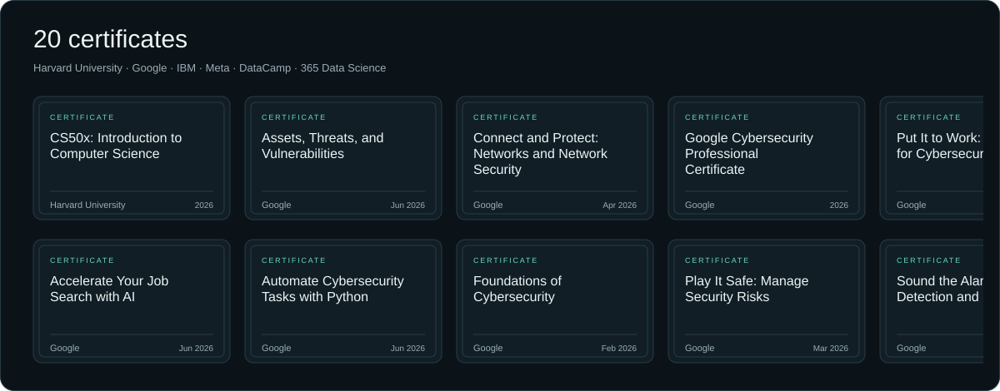</picture></a>

<a href="https://marwane-haddane.github.io/Marwane-Haddane/certificates/"><b>Open my interactive certificate wall ↗</b></a>

Details and verification links

| Certificate | Issuer | Date | Credential |
|---|---|---|---|
| CS50x: Introduction to Computer Science | Harvard University | 2026 | [View](https://cs50.harvard.edu/certificates/9b8fa55f-f037-4ffe-95af-85d90b1bb996) |
| Accelerate Your Job Search with AI | Google | Jun 2026 | [View](https://coursera.org/verify/GGCU2TIPXQVL) |
| Assets, Threats, and Vulnerabilities | Google | Jun 2026 | [View](https://coursera.org/verify/SEBED6F4BU1Z) |
| Automate Cybersecurity Tasks with Python | Google | Jun 2026 | [View](https://coursera.org/verify/5SF0V47SO2OB) |
| Connect and Protect: Networks and Network Security | Google | Apr 2026 | [View](https://coursera.org/verify/5P15IVIYLN9M) |
| Foundations of Cybersecurity | Google | Feb 2026 | [View](https://coursera.org/verify/R4HUDRWYTM16) |
| Google Cybersecurity Professional Certificate | Google | 2026 | [View](https://www.credly.com/badges/0a29ef8f-3456-49f6-9efd-95d20de84e39/public_url) |
| Play It Safe: Manage Security Risks | Google | Mar 2026 | [View](https://coursera.org/verify/6B5SAX66B155) |
| Put It to Work: Prepare for Cybersecurity Jobs | Google | Jun 2026 | [View](https://coursera.org/verify/R54TA5D29UFL) |
| Sound the Alarm: Detection and Response | Google | Jun 2026 | [View](https://coursera.org/verify/NFCZ6A330Y4P) |
| Tools of the Trade: Linux and SQL | Google | Apr 2026 | [View](https://coursera.org/verify/ULJAELPPYCFC) |
| Delivering Quality Work with Agility | IBM | Jan 2026 | [View](https://coursera.org/verify/KAJVII0EZU8J) |
| Introduction to Front-End Development | Meta | Jul 2025 | [View](https://coursera.org/verify/BSCP1B2EP78I) |
| Programming with JavaScript | Meta | Dec 2025 | [View](https://coursera.org/verify/X2FAPH0GMCYB) |
| AWS Security and Cost Management Concepts | DataCamp | Nov 2025 | [View](certificates/images/aws-security-and-cost-management-concepts.svg) |
| Introduction to Git | DataCamp | Mar 2026 | [View](https://www.datacamp.com/completed/statement-of-accomplishment/course/74c598de78a0536dc4fc35ddeb2d512203f3c2a6) |
| Working with Hugging Face | DataCamp | Feb 2026 | [View](https://www.datacamp.com/completed/statement-of-accomplishment/course/a1acbfd19378c99e98be66ba1179665a8f962956) |
| Working with Llama 3 | DataCamp | Feb 2026 | [View](https://www.datacamp.com/completed/statement-of-accomplishment/course/815f10e4d5f6a9b1ce0e77f6a3907bfcbba44092) |
| Introduction to Jupyter | 365 Data Science | 2024 | [View](https://learn.365datascience.com/c/a4d6354547/) |
| Introduction to Python | 365 Data Science | Nov 2025 | [View](https://learn.365datascience.com/c/b0e4a331c4/) |

## 🌐 Let's Connect:

  
  

## 📈 GitHub Stats

  
  

 

  

### Activity

<a href="https://github.com/Marwane-Haddane?tab=overview"><picture><source media="(prefers-color-scheme: dark)" srcset="assets/activity-v2-dark.svg"><source media="(prefers-color-scheme: light)" srcset="assets/activity-v2-light.svg"></picture></a>

[View contributions on GitHub](https://github.com/Marwane-Haddane?tab=overview)

Coding practice · LeetCode

## Projects

<table>
<tr>
<td width="50%" valign="top"><a href="https://robogenius.dev/"><picture><source media="(prefers-color-scheme: dark)" srcset="assets/project-robogenius-dark.svg"><source media="(prefers-color-scheme: light)" srcset="assets/project-robogenius-light.svg"></picture></a> <a href="https://robogenius.dev/">Live website ↗</a> · <a href="https://github.com/Marwane-Haddane/RoboGenius">Source code</a> · <a href="https://github.com/Marwane-Haddane/Robotics-X-RoboGenius">Robotics code</a></td>
<td width="50%" valign="top"><a href="https://github.com/Marwane-Haddane/WeSecure"><picture><source media="(prefers-color-scheme: dark)" srcset="assets/project-wesecure-dark.svg"><source media="(prefers-color-scheme: light)" srcset="assets/project-wesecure-light.svg"></picture></a> <a href="https://github.com/Marwane-Haddane/WeSecure">Source code</a></td>
</tr>
<tr>
<td width="50%" valign="top"><a href="https://github.com/Marwane-Haddane/hackai"><picture><source media="(prefers-color-scheme: dark)" srcset="assets/project-feedia-dark.svg"><source media="(prefers-color-scheme: light)" srcset="assets/project-feedia-light.svg"></picture></a> <a href="https://github.com/Marwane-Haddane/hackai">Source code</a></td>
<td width="50%" valign="top"><a href="https://github.com/Marwane-Haddane/HACKTOBER"><picture><source media="(prefers-color-scheme: dark)" srcset="assets/project-fleetsense-dark.svg"><source media="(prefers-color-scheme: light)" srcset="assets/project-fleetsense-light.svg"></picture></a> <a href="https://github.com/Marwane-Haddane/HACKTOBER">Source code</a></td>
</tr>
<tr>
<td width="50%" valign="top"><a href="https://github.com/Marwane-Haddane/driver-drowsiness-detection"><picture><source media="(prefers-color-scheme: dark)" srcset="assets/project-drowsiness-dark.svg"><source media="(prefers-color-scheme: light)" srcset="assets/project-drowsiness-light.svg"></picture></a> <a href="https://github.com/Marwane-Haddane/driver-drowsiness-detection">Source code</a></td>
<td width="50%" valign="top"><a href="https://memoria-9eac1.web.app/"><picture><source media="(prefers-color-scheme: dark)" srcset="assets/project-memoria-dark.svg"><source media="(prefers-color-scheme: light)" srcset="assets/project-memoria-light.svg"></picture></a> <a href="https://memoria-9eac1.web.app/">Live website ↗</a> · <a href="https://github.com/Marwane-Haddane/memoria">Source code</a></td>
</tr>
<tr>
<td width="50%" valign="top"><a href="https://github.com/Marwane-Haddane/vart"><picture><source media="(prefers-color-scheme: dark)" srcset="assets/project-vart-dark.svg"><source media="(prefers-color-scheme: light)" srcset="assets/project-vart-light.svg"></picture></a> <a href="https://github.com/Marwane-Haddane/vart">Source code</a></td>
<td width="50%" valign="top"><a href="https://maison-intelligent-7b24c.web.app/"><picture><source media="(prefers-color-scheme: dark)" srcset="assets/project-smarthome-dark.svg"><source media="(prefers-color-scheme: light)" srcset="assets/project-smarthome-light.svg"></picture></a> <a href="https://maison-intelligent-7b24c.web.app/">Live website ↗</a> · <a href="https://github.com/Marwane-Haddane/SmartHome">Source code</a></td>
</tr>
<tr>
<td width="50%" valign="top"><a href="https://github.com/Marwane-Haddane/slidelink"><picture><source media="(prefers-color-scheme: dark)" srcset="assets/project-slidelink-dark.svg"><source media="(prefers-color-scheme: light)" srcset="assets/project-slidelink-light.svg"></picture></a> <a href="https://github.com/Marwane-Haddane/slidelink">Source code</a> · <a href="https://github.com/Marwane-Haddane/slidelink/releases">Downloads</a></td>
<td width="50%" valign="top"><a href="https://github.com/Marwane-Haddane/orbit"><picture><source media="(prefers-color-scheme: dark)" srcset="assets/project-orbit-dark.svg"><source media="(prefers-color-scheme: light)" srcset="assets/project-orbit-light.svg"></picture></a> <a href="https://github.com/Marwane-Haddane/orbit">Source code</a> · <a href="https://github.com/Marwane-Haddane/orbit/releases">Downloads</a></td>
</tr>
<tr>
<td width="50%" valign="top"><a href="https://github.com/Marwane-Haddane/moru-desktop"><picture><source media="(prefers-color-scheme: dark)" srcset="assets/project-moru-dark.svg"><source media="(prefers-color-scheme: light)" srcset="assets/project-moru-light.svg"></picture></a> <a href="https://github.com/Marwane-Haddane/moru-desktop">Source code</a> · <a href="https://github.com/Marwane-Haddane/moru-desktop/releases">Downloads</a></td>
<td width="50%" valign="top"><a href="https://github.com/Marwane-Haddane/mysoil-app"><picture><source media="(prefers-color-scheme: dark)" srcset="assets/project-mysoil-dark.svg"><source media="(prefers-color-scheme: light)" srcset="assets/project-mysoil-light.svg"></picture></a> <a href="https://github.com/Marwane-Haddane/mysoil-app">Source code</a> · <a href="https://github.com/Marwane-Haddane/mysoil-app/releases/latest/download/MySoil-Android-arm64.apk">Android APK</a></td>
</tr>
<tr>
<td width="50%" valign="top"><a href="https://github.com/Marwane-Haddane/rihla-app"><picture><source media="(prefers-color-scheme: dark)" srcset="assets/project-rihla-dark.svg"><source media="(prefers-color-scheme: light)" srcset="assets/project-rihla-light.svg"></picture></a> <a href="https://github.com/Marwane-Haddane/rihla-app">Source code</a> · <a href="https://github.com/Marwane-Haddane/rihla-app/releases/latest/download/RIHLA-Android.apk">Android APK</a></td>
<td width="50%" valign="top"><a href="https://bara-salfa-by-marwane.web.app/"><picture><source media="(prefers-color-scheme: dark)" srcset="assets/project-barasalfa-dark.svg"><source media="(prefers-color-scheme: light)" srcset="assets/project-barasalfa-light.svg"></picture></a> <a href="https://bara-salfa-by-marwane.web.app/">Live website ↗</a> · <a href="https://github.com/Marwane-Haddane/barasalfa-app">Source code</a> · <a href="https://github.com/Marwane-Haddane/barasalfa-website">Web source</a></td>
</tr>
<tr>
<td width="50%" valign="top"><a href="https://labelle-maison.web.app/"><picture><source media="(prefers-color-scheme: dark)" srcset="assets/project-furniture-dark.svg"><source media="(prefers-color-scheme: light)" srcset="assets/project-furniture-light.svg"></picture></a> <a href="https://labelle-maison.web.app/">Live website ↗</a> · <a href="https://github.com/Marwane-Haddane/Furniture">Website source</a> · <a href="https://github.com/Marwane-Haddane/furniture-mobile-app">Android source</a> · <a href="https://github.com/Marwane-Haddane/furniture-mobile-app/releases/latest/download/Furniture-Android.apk">Android APK</a></td>
<td width="50%" valign="top"><a href="https://github.com/Marwane-Haddane/su1-tarvel-assistant"><picture><source media="(prefers-color-scheme: dark)" srcset="assets/project-su1-dark.svg"><source media="(prefers-color-scheme: light)" srcset="assets/project-su1-light.svg"></picture></a> <a href="https://github.com/Marwane-Haddane/su1-tarvel-assistant">Source code</a></td>
</tr>
<tr>
<td width="50%" valign="top"><a href="https://habit-tracker4marwane.web.app/"><picture><source media="(prefers-color-scheme: dark)" srcset="assets/project-habit-dark.svg"><source media="(prefers-color-scheme: light)" srcset="assets/project-habit-light.svg"></picture></a> <a href="https://habit-tracker4marwane.web.app/">Live website ↗</a> · <a href="https://github.com/Marwane-Haddane/habit-tracker">Source code</a></td>
<td width="50%" valign="top"><a href="https://gdgensaf.web.app/"><picture><source media="(prefers-color-scheme: dark)" srcset="assets/project-gdg-dark.svg"><source media="(prefers-color-scheme: light)" srcset="assets/project-gdg-light.svg"></picture></a> <a href="https://gdgensaf.web.app/">Live website ↗</a></td>
</tr>
</table>

**More work:** [Shellter Store · live website](https://shellterstore.web.app/) · [Cybersecurity exercises](https://github.com/Marwane-Haddane/CodeAlpha-CyberSec-Projects)

---

Fès, Morocco · <a href="mailto:marwanehaddane5@gmail.com">marwanehaddane5@gmail.com</a>

